# Doctor Tracker: frontend

**Doctor Tracker** is a secure admin portal for a hospital network. It replaces scattered spreadsheets with one
place where an administrator can see every doctor, the patients each one looks after, and how admissions are
trending. Staff can find any record in a keystroke, narrow lists by specialty, hospital, condition, status or
date, add patients straight under the responsible doctor, and keep records current. The dashboard answers the
daily questions (how many patients are admitted right now, which doctors carry the heaviest load, what
conditions are rising) without anyone running a report. This repository is the web app; it talks to a
separate [Express + MongoDB API](https://github.com/Monjur14/Care_Guide-Doctor_Tracker_Backend) over REST.

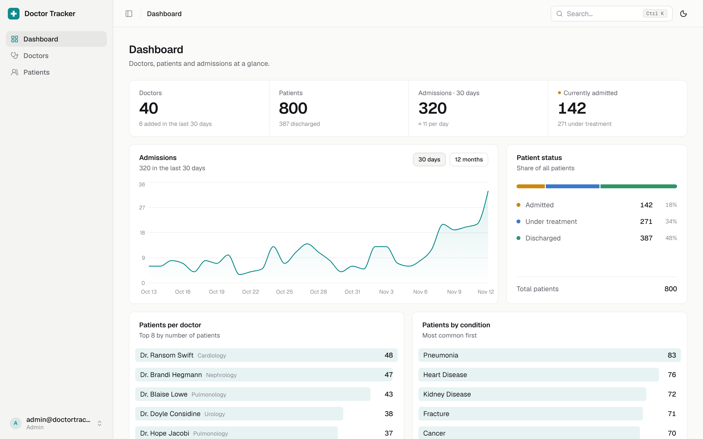

**Stack:** Next.js 16 (App Router) · React 19 · TypeScript · Tailwind CSS 4 · shadcn/ui (Radix) ·
TanStack Query 5 · nuqs · React Hook Form + Zod · Recharts 3

---

## Contents

1. [Setup guide](#setup-guide)
2. [System architecture](#system-architecture)
3. [Technical decisions](#technical-decisions)
4. [Visual evidence](#visual-evidence)
5. [Reference](#reference): configuration, scripts, project structure, features, deployment

---

## Setup guide

### Prerequisites

- **Node.js 22.9 or newer** (`node -v`). The exact version is in [`.nvmrc`](.nvmrc).
- **The backend API running locally.** Follow the setup in the
  [backend repository](https://github.com/Monjur14/Care_Guide-Doctor_Tracker_Backend#setup-guide); by default it
  listens on `http://localhost:4000` and its seed script creates the admin account you sign in with.

### Steps

1. **Clone and install**

   ```bash
   git clone https://github.com/Monjur14/Care_Guide-Doctor_Tracker_Frontend.git
   cd Care_Guide-Doctor_Tracker_Frontend
   npm install
   ```

2. **Create your environment file** from the template ([`.env.example`](.env.example)):

   ```bash
   cp .env.example .env.local
   ```

   | Variable | Required | Example | Purpose |
   |---|---|---|---|
   | `API_URL` | yes | `http://localhost:4000` | Where the API runs. Read on the server only; Next.js forwards `/api/*` there |
   | `NEXT_PUBLIC_DEMO_EMAIL` | no | `admin@doctortracker.dev` | With the password below, shows a one-click **Use demo admin account** button |
   | `NEXT_PUBLIC_DEMO_PASSWORD` | no | | Must match the backend's `SEED_ADMIN_PASSWORD`. Sent to the browser, so use a demo account only |

3. **Start the dev server**

   ```bash
   npm run dev
   ```

4. **Sign in** at [http://localhost:3000](http://localhost:3000) with the backend's `SEED_ADMIN_EMAIL` /
   `SEED_ADMIN_PASSWORD` (or the demo button if you set the demo variables).

To check a production build locally: `npm run build && npm start`.

> **Troubleshooting:** a "Can't reach the server" message on sign-in means the API isn't running or `API_URL`
> is wrong. Restart `npm run dev` after editing `.env.local`; Next.js only reads it at startup.

---

## System architecture

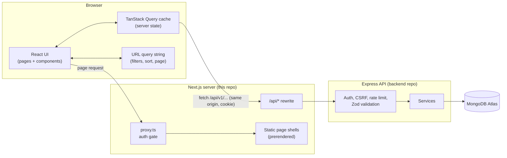

**How a request flows**

1. **Page load.** The browser requests a page. `src/proxy.ts` checks only whether a session cookie exists: with
   none, it redirects to `/login`; with one, it skips `/login`. Pages are static shells prerendered at build
   time (`cacheComponents`), so they arrive immediately.
2. **Data.** Components read their filters from the URL and ask TanStack Query for data. The query calls
   `/api/v1/...` on the **same origin**; Next.js rewrites it to `API_URL`. The browser sends the `httpOnly`
   session cookie automatically, and no token is ever visible to JavaScript.
3. **API.** The Express API verifies the cookie on every request (signature, expiry, revocation), validates the
   input with Zod, queries MongoDB through indexes, and returns `{ data, meta }` or a structured error.
4. **Render and cache.** The response is cached under a key built from its parameters, so going back to a
   previous page or filter is instant. Mutations (create, edit, delete) invalidate exactly the queries they
   affect: adding a patient refreshes the patient lists, that doctor's count and the dashboard.
5. **Session ends.** Any `401` clears the cache and sends the user to `/login?next=<page>`. After signing in
   they land back where they were (only same-site paths are accepted, so `next` can't redirect elsewhere).

**Shared contract.** `shared/` (the local package `@doctor-tracker/shared`) holds the Zod schemas, enums and
response types. The backend repo has an identical copy, so a form here validates with exactly the rules the
API enforces, and the TypeScript types of every response match what the API sends.

---

## Technical decisions

### 1. TanStack Query + URL state instead of Redux (or Context)

**The problem.** Almost all of the app's state is a copy of data that lives on the server (doctors,
patients, statistics), plus the controls that decide *which* data to show (search, filters, sort, page). Very
little is purely client-side.

**Options considered**

| | Redux Toolkit (+ RTK Query) | React Context + `useEffect` fetching | **TanStack Query + URL (nuqs)** |
|---|---|---|---|
| Caching, deduplication, cancellation | RTK Query only | Hand-written | Built in |
| Stale data while the next page loads | Manual | Manual | `keepPreviousData` |
| Filters survive reload, back/forward and sharing | Extra sync code | Extra sync code | Built in (the URL *is* the state) |
| Re-renders | Selectors needed | Every consumer re-renders on any change | Per-query subscriptions |
| Boilerplate | Slices, store, providers | Providers, reducers, effects | One `queries.ts` per feature |

**Decision.** Treat server data as a **cache**, not as app state, and keep view state in the **URL**.

- Each feature exposes typed hooks (`useDoctors(params)`, `useCreatePatient()`) and a key factory. The
  parameters are part of the key, so every filter combination is cached separately.
- `keepPreviousData` keeps the current page on screen (slightly dimmed) while the next one loads, so tables
  never flash empty. Requests made obsolete by newer typing are aborted through `AbortSignal`.
- Mutations invalidate by key prefix (`["patients"]`, `["doctors"]`, `["stats"]`), so there is no manual
  cache editing to get wrong.
- `nuqs` binds search, filters, sort, page and page size to the query string. A shared link, a reload or the
  back button reproduces the exact view, which also makes the app easy to test and demo.

**Trade-off.** There is no single store to inspect in devtools, and URL updates have to be debounced (search
waits 300 ms). In exchange, no state-management boilerplate exists at all, and the hardest parts (caching,
refetching, race conditions) come from a well-tested library.

### 2. Same-origin API proxy with an `httpOnly` cookie, instead of calling the API directly with a token

**The problem.** The frontend and the API are separate deployments on different domains. The browser needs to
stay authenticated across both without exposing the session to scripts.

**Options considered**

- **Bearer token in `localStorage`, browser calls the API's domain.** Simple, but any XSS can read and steal
  the token, and every request is cross-origin (CORS preflights, more latency).
- **Cookie set by the API's domain, browser calls it directly.** The token is safe from scripts, but it is a
  *third-party* cookie from the page's point of view. Safari and Chrome's tracking protections block or
  partition those, so sessions break in exactly the browsers reviewers use.
- **Proxy through the frontend's own origin (chosen).** `next.config.ts` rewrites `/api/:path*` to `API_URL`.
  The browser only ever talks to the site it is on.

**Decision and consequences**

- The session cookie is **first-party**, `httpOnly`, `SameSite=Lax` and `Secure` in production, so JavaScript
  can't read it and it works with third-party cookies blocked.
- No CORS preflight on browser requests; the page's Content Security Policy can restrict `connect-src` to
  `'self'`.
- `proxy.ts` can make a fast, optimistic redirect decision on the server (cookie present or not) before any
  page renders, which avoids a flash of the app shell for signed-out visitors. The real check stays on the API.
- `API_URL` is a server-only variable, so the backend address can change without rebuilding client code.

**Trade-off.** Every API call makes one extra hop through the Next.js server, and the frontend deployment must
know the backend URL. On Vercel the hop adds only a few milliseconds, and it removes a whole class of auth and
CORS problems.

---

## Visual evidence

All screenshots are taken from the running app with the seeded demo data (40 doctors, 800 patients).

### Desktop

| | |
|---|---|
| **Sign in (light):** form beside a live preview of the dashboard 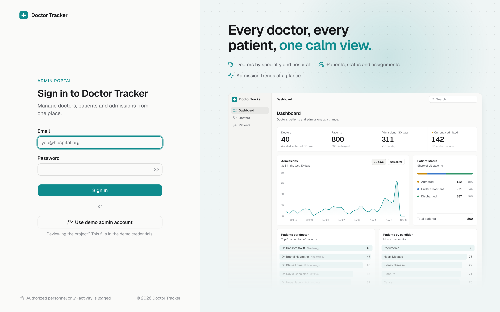 | **Sign in (dark)** 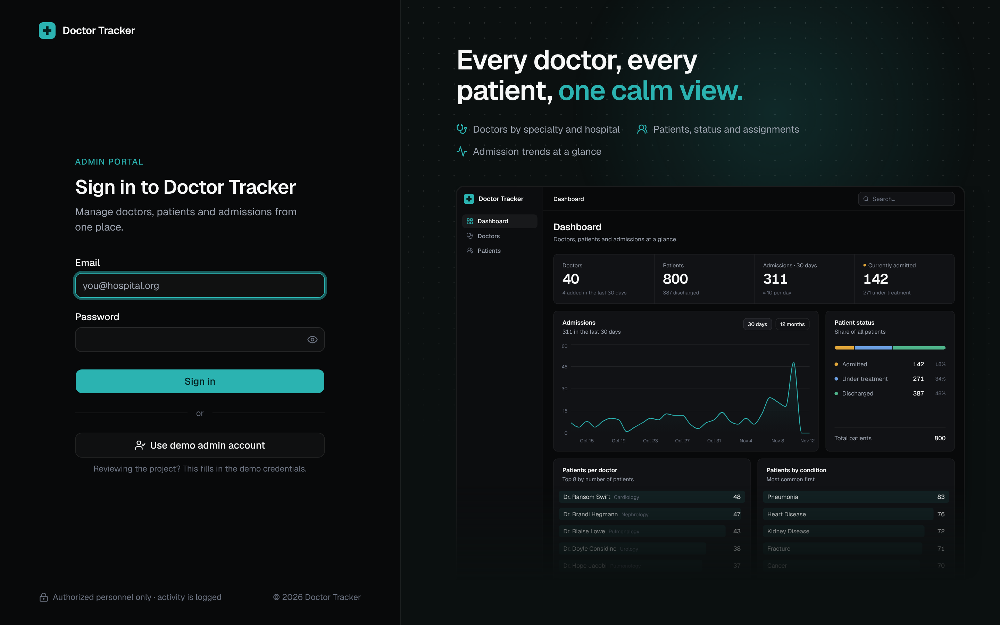 |
| **Dashboard (light):** KPIs, admissions trend, status split, top doctors, conditions  | **Dashboard (dark)** 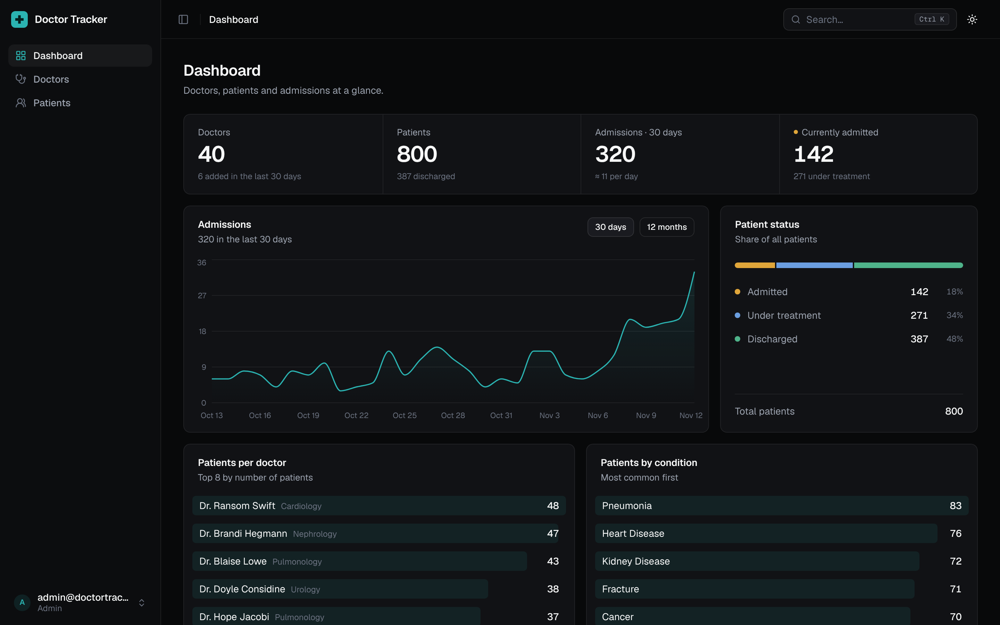 |
| **Doctors:** search, specialization, hospital and date filters, sortable columns 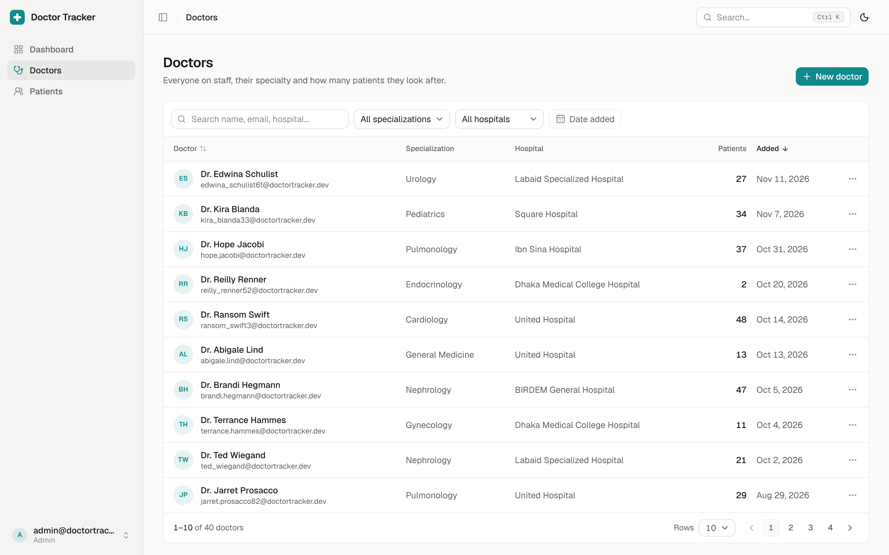 | **Doctor detail:** contact facts and that doctor's own patient list 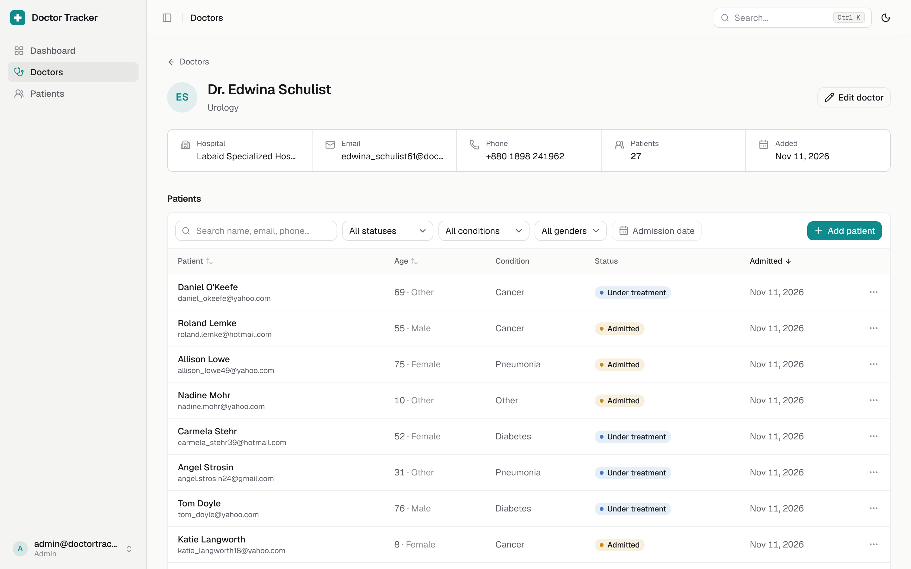 |
| **Patients:** filtered to admitted, with status pills and pagination 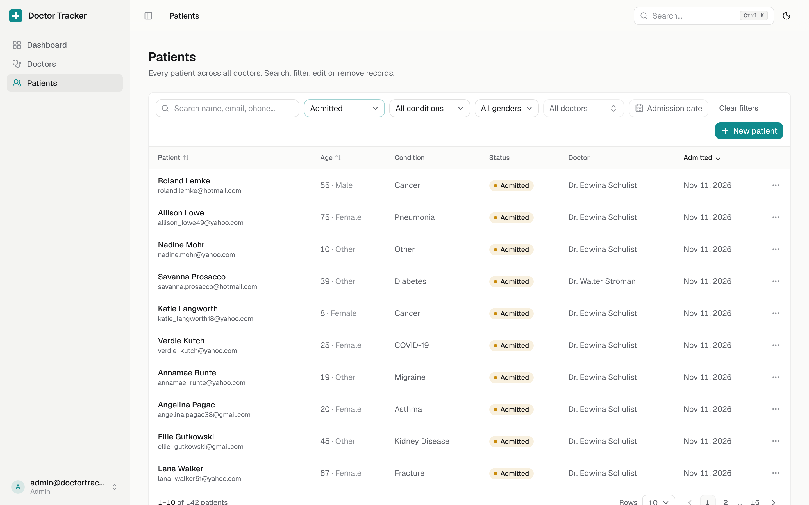 | **New patient drawer:** shared Zod validation, doctor picker 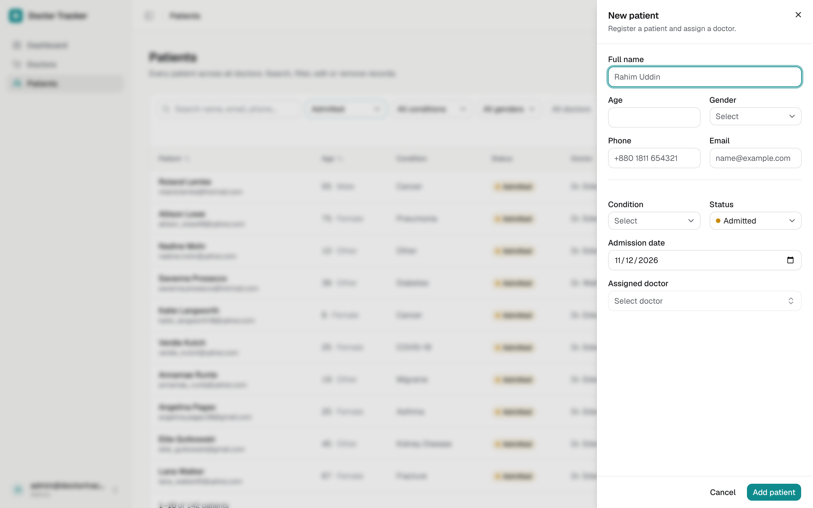 |
| **Ctrl+K command menu:** search doctors and patients from anywhere 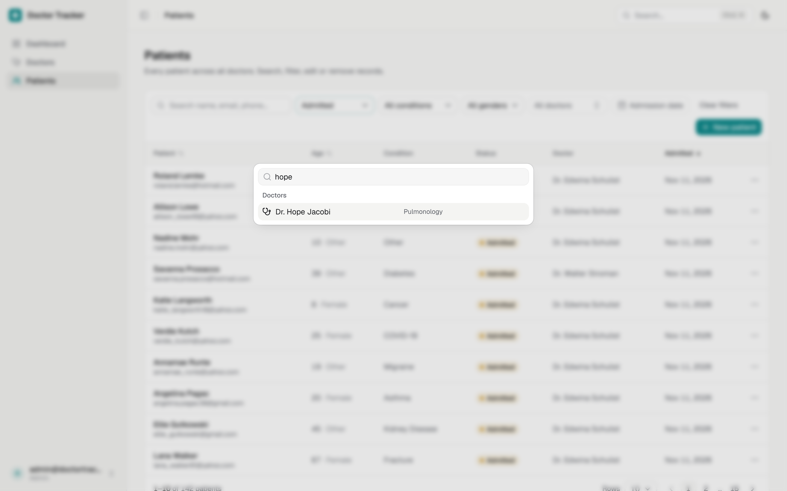 | |

### Mobile (iPhone 14, 390 × 844)

| Sign in | Dashboard | Doctors | Patients | Navigation |
|---|---|---|---|---|
| 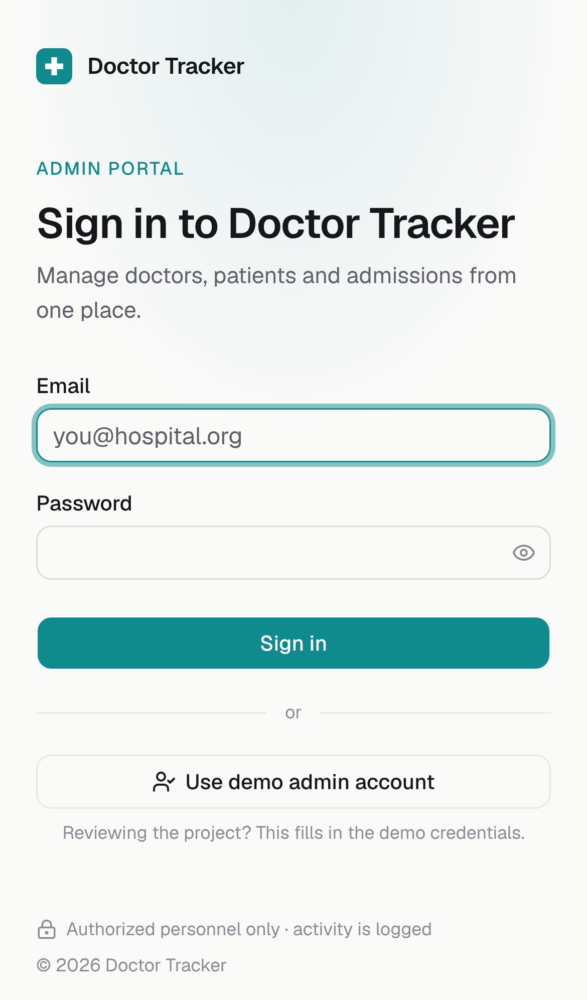 | 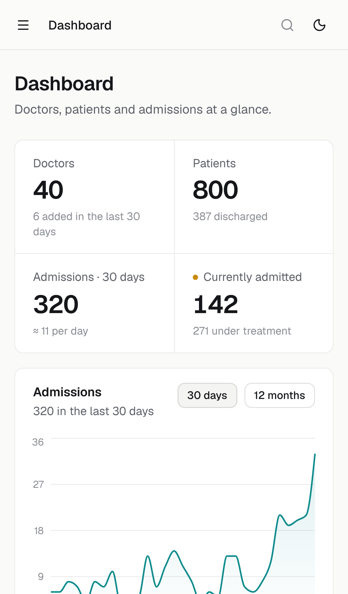 | 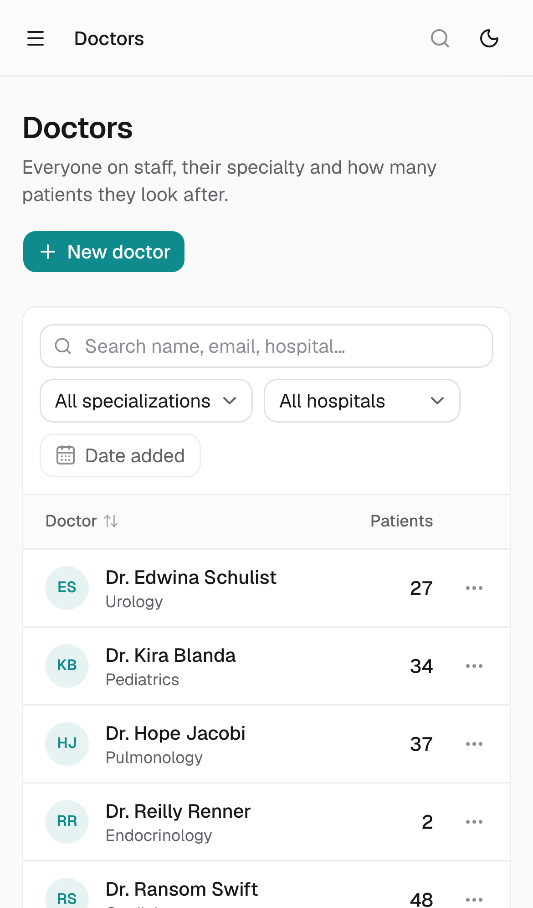 | 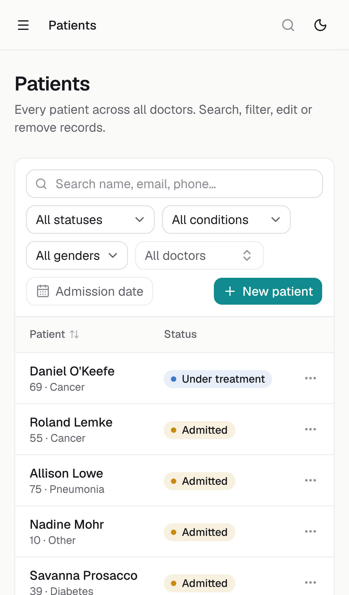 | 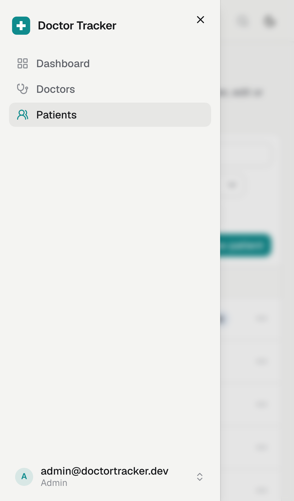 |

On phones, secondary table columns fold into the first column (for example "69 · Cancer" under a patient's
name), filters wrap, and the sidebar becomes a slide-in drawer.

---

## Reference

### Scripts

| Command | What it does |
|---|---|
| `npm run dev` | Dev server on port 3000 (Turbopack) |
| `npm run build` / `npm start` | Production build, then serve it |
| `npm run typecheck` | `tsc --noEmit` |
| `npm run lint` | ESLint (Next.js + React Hooks rules) |

### Project structure

```
shared/                   @doctor-tracker/shared: Zod schemas, enums and API types (same as the backend repo)
src/
├─ app/
│  ├─ login/              sign-in page (form + live dashboard preview)
│  ├─ (app)/              signed-in area, wrapped in the app shell
│  │  ├─ dashboard/
│  │  ├─ doctors/         list, and [id]/ for a doctor and their patients
│  │  └─ patients/
│  └─ layout.tsx, providers.tsx, globals.css   (theme tokens, motion keyframes)
├─ features/              one folder per domain: queries + components
│  ├─ auth/               login form, demo fill, sign-in preview
│  ├─ dashboard/          KPI strip, admissions chart, status, top doctors, conditions
│  ├─ doctors/            table, detail page, form drawer, doctor picker (server-searched combobox)
│  ├─ patients/           table (shared by /patients and the doctor page), form drawer, delete dialog
│  └─ meta/               filter options (hospitals, enums)
├─ components/
│  ├─ app-shell/          sidebar, header, Ctrl+K command menu, theme toggle, user menu
│  ├─ data-table/         debounced search, filter select, date range, pagination, sortable header
│  └─ ui/                 shadcn/ui primitives
├─ lib/                   api client, formatting, form error mapping, status colours
└─ proxy.ts               auth gate (Next.js 16's replacement for middleware.ts)
```

### Features

- **Dashboard:** totals, admissions over 30 days or 12 months (status breakdown on hover), patient status
  split, top doctors by patient count, patients by condition.
- **Doctors:** search; filter by specialization, hospital and date added; sort; paginate. Each doctor has a
  page with contact details and their own patient table, where patients are added and removed. Create and
  edit in a side drawer.
- **Patients:** search; filter by status, condition, gender, doctor and admission date; sort by name, age or
  admission date; edit (including reassigning the doctor) and delete with confirmation.
- **Ctrl+K command menu:** jump to pages, switch theme, search doctors and patients by name.
- **Sign-in page:** the real dashboard components render a live preview, fed from a sample data snapshot
  (the stats API needs a session). It is inert and hidden from screen readers.

### UX and accessibility

- Skeleton loading states shaped like the real layout; empty and error states with a retry on every list.
- Dates are shown and edited as calendar days in UTC, so a date reads back the same in any time zone.
- Every action works from the keyboard, focus rings are visible, and dialogs trap focus.
- Light and dark themes follow the system, with a toggle. `prefers-reduced-motion` turns all motion off.

### Deployment (Vercel)

1. Import this repo as a Vercel project (framework preset: Next.js).
2. Set `API_URL` to the deployed backend URL (no trailing slash).
3. Optionally set `NEXT_PUBLIC_DEMO_EMAIL` / `NEXT_PUBLIC_DEMO_PASSWORD` for reviewers.
4. Add the frontend's domain to the backend's `CORS_ORIGINS`.

GitHub Actions (`.github/workflows/ci.yml`) type checks, lints and builds every push and pull request. Pages
send a strict Content Security Policy and security headers (see `next.config.ts`).
